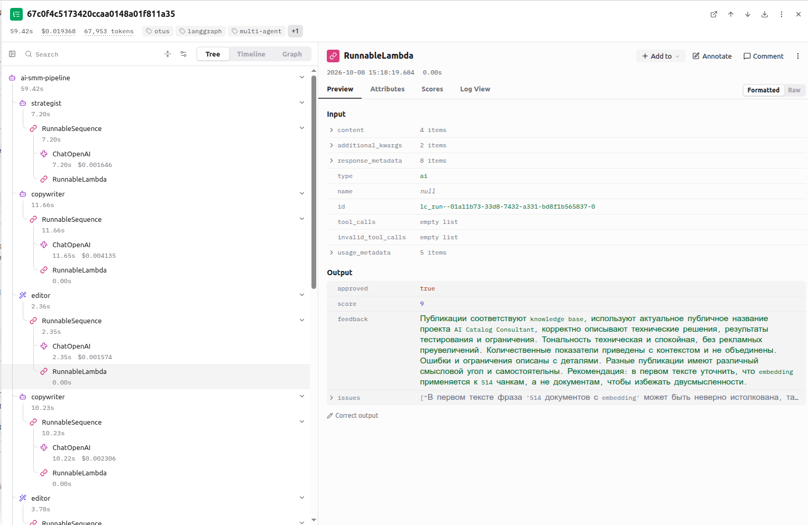
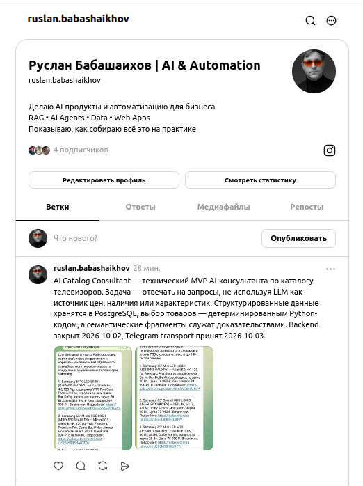

# AI SMM Department 2.0

**AI-powered content operations platform** — мультиагентная система для подготовки, редакторского контроля, согласования, планирования и публикации контента.

Python · LangGraph · FastAPI · React · PostgreSQL · Threads Graph API

AI SMM Department объединяет AI-агентов и привычные инструменты контент-команды в единый процесс: от идеи и черновика до проверки человеком и запланированной отправки в социальную сеть. Это развивающийся инженерный продукт с работающим publication runtime и отдельным веб-интерфейсом управления.

> **Статус на октябрь 2026:** production worker для одобренных публикаций работает с Threads; Control Center v1 развёрнут в закрытом режиме **read-only для бизнес-операций**. Изменения материалов через production UI пока отключены. Некоторые функции платформы разрабатываются и не включены в production.

## Что решает

- **Подготовка контента:** AI-агенты работают с фактами и редакционными требованиями проекта.
- **Редакторский контроль:** черновики проходят автоматические проверки и цикл доработки.
- **Human-in-the-loop:** публикация возможна только после явного одобрения человеком.
- **Управляемая доставка:** PostgreSQL-очередь, расписание, ограничения порядка публикаций и защита от дублей.
- **Прозрачность:** история решений и попыток публикации, аудит действий, Langfuse-трассировки.
- **Веб-управление:** React Control Center поверх FastAPI; операции публикации остаются изолированы в worker.

## Архитектура

```text
Knowledge base + editorial policy
                |
                v
      LangGraph agent workflow
   Strategist → Copywriter ⇄ Editor
                |
                v
      Content & revisions (PostgreSQL)
                |
                v
          Human approval
                |
                v
    Approved publication / schedule
                |
                v
    PostgreSQL queue + APScheduler
                |
                v
       Publication worker ──────→ Threads Graph API
                |
                v
       Status / attempts / audit

Browser → React Control Center → FastAPI → PostgreSQL
                    (no direct publishing)
```

### AI-агенты

| Агент | Задача |
| --- | --- |
| **Strategist** | Формирует темы и контент-план на основе базы знаний |
| **Copywriter** | Создаёт публикации и дорабатывает тексты по замечаниям |
| **Editor** | Проверяет факты, стиль и ограничения формата; может отклонить черновик |
| **Publisher** | Применяет ограничения редакционного пайплайна; непосредственную отправку запланированных записей в production выполняет отдельный worker |

### Контур управления и исполнения

**FastAPI + React Control Center** — интерфейс для просмотра проектов, редакционных сущностей, ревизий, очереди, истории попыток и аудита. Предусмотрены RBAC, серверные сессии, CSRF-защита и контроль конкурентных изменений.

**PostgreSQL + worker** — отдельный execution plane. Worker получает готовые записи из очереди, учитывает расписание, порядок контентных серий, idempotency и безопасную обработку неопределённых результатов внешнего API. При потенциально неоднозначном ответе Threads запись переводится в `needs_review`, а не публикуется повторно автоматически.

**Безопасность публикаций:** автоматическая генерация не равна автоматическому одобрению. Одобрение привязано к конкретной неизменяемой ревизии и действию человека. Свежие развёртывания используют dry-run по умолчанию; live-публикация — отдельная управляемая конфигурация.

Подробности: [архитектурные решения](docs/adr/) · [API](docs/api.md) · [контентные серии](docs/content-series.md) · [безопасность публикаций](docs/adr/automation-and-publication-safety.md).

## Реализованные возможности

| Область | Возможности |
| --- | --- |
| Генерация | LangGraph workflow, редакторская обратная связь и повторная генерация |
| Knowledge base | Проектные факты и редакционная политика в Markdown/YAML |
| Управление контентом | Content items, immutable revisions, approval и provenance |
| Доставка | Отложенные публикации, PostgreSQL queue, worker, retries и leases |
| Социальные сети | Threads: текст, изображения, карусели и серии/ответы |
| Медиа | Проверка и размещение медиа в доступном по HTTPS хранилище |
| Безопасность | Human approval, контроль ролей, аудит, барьеры от дублей |
| Наблюдаемость | Langfuse, история попыток, диагностика ошибок |
| Интерфейс | React/Vite Control Center + FastAPI; production UI пока read-only |

Первый прикладной кейс — серия публикаций об **AI Catalog Consultant**. Три материала были успешно опубликованы в Threads в октябре 2026 года, включая карусель. Это подтверждённый сценарий доставки, а не заявление о полной готовности всех запланированных функций.

## Технологии

| Слой | Стек |
| --- | --- |
| AI и orchestration | Python 3.12, LangGraph, LangChain, OpenAI API, Pydantic |
| Backend | FastAPI, SQLAlchemy, Alembic |
| Frontend | React 19, TypeScript, Vite, TanStack Query |
| Данные | PostgreSQL 16 |
| Runtime | APScheduler, Docker Compose |
| Публикации и медиа | Threads Graph API, HTTPS media storage, local/SFTP uploader |
| Наблюдаемость и качество | Langfuse, pytest, Vitest, Ruff |
| Управление зависимостями | uv, npm |

## Быстрый старт для разработки

Необходимы Python 3.12, [uv](https://docs.astral.sh/uv/) и, для веб-интерфейса, Node.js/npm. Для сценариев с БД понадобится PostgreSQL.

```bash
git clone https://github.com/rbabashaikhov/ai-smm-department.git
cd ai-smm-department
uv sync
cp .env.example .env
```

Заполните только необходимые для выбранного сценария переменные в `.env`. **Не коммитьте токены, пароли и ключи.** Для локального знакомства с агентами доступен dry-run:

```bash
uv run python -u scripts/run_demo.py
```

Этот сценарий **не публикует** контент в Threads. Для него могут потребоваться настроенные OpenAI и Langfuse credentials.

Локальный backend:

```bash
AI_SMM_API_COOKIE_SECURE=false uv run uvicorn ai_smm.api.app:create_app --factory --host 127.0.0.1 --port 8000
```

Локальный frontend (в отдельном терминале):

```bash
cd web
npm ci
npm run dev
```

Для полноценного workflow с БД, миграциями, worker и авторизацией используйте проектные [API-документы](docs/api.md), [инструкции по runtime](docs/runtime-packaging.md) и [README веб-интерфейса](web/README.md). Не запускайте миграции и live-команды на production без отдельной проверки состояния очереди и backup.

## Production и эксплуатация

Production разделён на независимые компоненты: публикационный worker и закрытый Control Center. Веб-интерфейс не имеет прямого пути вызова Threads API. Управление миграциями выполняется отдельно от старта контейнеров.

На последнем **документированном production-состоянии** Control Center работает в режиме read-only для бизнес-операций с ограниченной ролью БД. Наличие API для редактирования и локально проверенных механизмов авторизации **не означает**, что изменение материалов включено в production. Переключение требует отдельной приёмки и проверок безопасности.

- [Production acceptance](docs/production-acceptance-smm-024c2.md)
- [Deployment runbook](docs/control-center-deployment.md)
- [Rollback](docs/control-center-rollback.md)
- [Открытые ограничения и follow-ups](docs/follow-ups.md)

## Направления развития

Платформа развивается в сторону управления несколькими контентными проектами с разными авторами, голосом бренда, настройками и каналами. Следующие направления **не следует считать реализованными только на основании roadmap**:

- полноценные workflow создания и согласования материалов в production Control Center;
- изоляция и настройка нескольких брендов и редакционных профилей через интерфейс;
- Image Agent и Video Agent;
- дополнительные каналы публикаций;
- аналитика эффективности контента и feedback loop для следующих кампаний.

Текущие ограничения и критерии допуска изменений отражаются в [follow-up register](docs/follow-ups.md).

## Демонстрация

**Langfuse: трассировка мультиагентного процесса**



**Threads: опубликованная карусель**



## Документация

- [HTTP API и модель доступа](docs/api.md)
- [Операционная модель](docs/operations.md)
- [Развёртывание runtime](docs/runtime-packaging.md)
- [Контентные серии](docs/content-series.md)
- [Решения по безопасности публикаций](docs/adr/automation-and-publication-safety.md)
- [Web Control Center](web/README.md)

---

**Автор:** [Руслан Бабашаихов](https://github.com/rbabashaikhov)

AI SMM Department — самостоятельный развивающийся проект на пересечении AI engineering, backend architecture и content operations.
